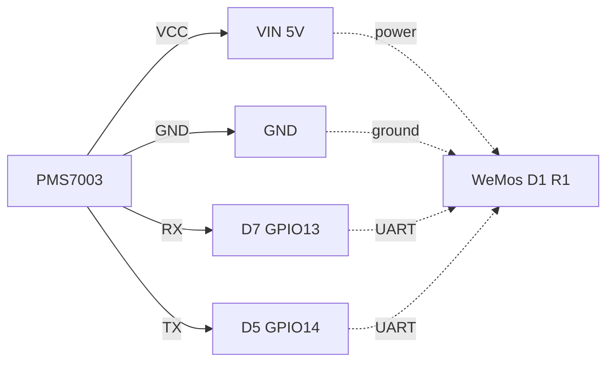

# PMS7003 Cloud Air‑Quality Monitor

A **PM1.0 / PM2.5 / PM10 air-quality monitoring** stack: a **WeMos D1 R1** (ESP8266) reads a **PMS7003** particulate-matter sensor over UART, `POST`s each sample to **Supabase**, and a **SvelteKit** dashboard (deployed to **Vercel**) shows live and historical readings.


> The firmware on `firmware/src/main.cpp` is implemented and uploading today. The SvelteKit dashboard renders the latest samples live via Supabase Realtime — see the [Dashboard](#-dashboard-app) section below.

For the hardware build (BOM, wiring, pin-safety rationale, first-power-up checklist), see [`firmware/hardware/README.md`](firmware/hardware/README.md).

---

## ✨ What works today

- ✅ PMS7003 frame parsing via [`fu-hsi/PMS Library`](https://github.com/fu-hsi/PMS)
- ✅ Wi‑Fi connection (background, non‑blocking on first boot)
- ✅ Local serial logging every loop tick: `[Sensor Task] Local Realtime -> PM1: … | PM2.5: … | PM10: …`
- ✅ Supabase `POST` every `upload_interval` ms (default **60 s**), with a connectivity skip when offline so the loop never blocks waiting for the cloud
- ✅ One‑in‑one‑out sample buffer (`std::optional<PmData>`) — the sensor never waits for the upload

---

## 🧰 Tech stack

| Layer        | Tech                                                              |
| ------------ | ----------------------------------------------------------------- |
| Sensor       | **PMS7003** (Plantower, UART 9600 8N1)                            |
| MCU          | **WeMos D1 R1** (ESP8266, 80 MHz, Wi‑Fi)                         |
| Firmware     | **PlatformIO** + Arduino framework, C++20 (`-std=gnu++20`)        |
| Cloud DB     | **Supabase** (Postgres + PostgREST)                               |
| Frontend     | **SvelteKit 2** + **Svelte 5** (runes mode forced) + TypeScript   |
| Styling      | **Tailwind CSS 4**                                                |
| Deploy       | **Vercel** via `@sveltejs/adapter-vercel`                         |
| Package mgr  | **pnpm**                                                          |

---

## 📁 Repository layout

```
pms7003-esp8266-cloud/
├── README.md          ← you are here
├── LICENSE            ← MIT
├── firmware/          ← PlatformIO project for the WeMos D1 R1
│   ├── platformio.ini
│   ├── include/       ← (reserved for header files)
│   ├── lib/           ← (reserved for local libs)
│   ├── src/main.cpp   ← firmware: read sensor + upload to Supabase
│   └── test/
└── app/               ← SvelteKit dashboard (Vercel adapter)
    ├── package.json
    ├── vite.config.ts
    └── src/
        ├── app.html
        ├── app.d.ts
        ├── lib/
        └── routes/
            ├── +layout.svelte
            ├── +page.svelte
            └── layout.css
```

---

## 🔌 Hardware

### Bill of materials

| Qty | Part                                | Notes                       |
| --- | ----------------------------------- | --------------------------- |
| 1   | WeMos D1 R1                         | ESP8266, micro‑USB powered  |
| 1   | PMS7003 module                      | UART 9600 8N1               |
| 1   | Breadboard + jumper wires           |                             |
| 1   | Micro‑USB cable                     | Data cable, not charge‑only |

### Wiring

The PMS7003 speaks UART at **9600 8N1**. The firmware uses `SoftwareSerial` with **D5 / GPIO14 as RX** and **D7 / GPIO13 as TX**, avoiding the UART0 pins shared with the USB-serial chip used for flashing.

| PMS7003 pin | Wire   | WeMos D1 R1 pin | Notes                       |
| ----------- | ------ | --------------- | --------------------------- |
| 1 and 2 VCC | red    | **5V / VIN**    | Tie both VCC pins to 5 V    |
| 3 and 4 GND | black  | **G**           | Tie both GND pins to ground |
| 7 RX        | yellow | **D7** (GPIO13) | MCU **TX** → sensor **RX** |
| 9 TX        | green  | **D5** (GPIO14) | Sensor **TX** → MCU **RX** |
| 5 RESET, 6/8 NC, 10 SET | — | leave floating | No connection required |



> If you see garbled frames, double‑check the TX/RX crossover — sensor RX must face MCU TX, and vice versa. Let the fan settle **≥ 30 s** before trusting the first reading.

For the complete connector pinout and boot-safety notes, see [`firmware/hardware/README.md`](firmware/hardware/README.md).

---

## ☁️ Supabase setup

### 1. Create the table, permissions, and Realtime publication

In **SQL editor**, run:

```sql
create table public.pm_logs (
  id          bigint generated by default as identity primary key,
  pm1         integer     not null,        -- μg/m³
  pm2_5       integer     not null,        -- μg/m³
  pm10        integer     not null,        -- μg/m³
  created_at  timestamptz not null default now()
);

create index pm_logs_created_at_idx
  on public.pm_logs (created_at desc);

-- Row Level Security
alter table public.pm_logs enable row level security;

-- The dashboard reads and the single sensor writes with the anon key.
grant select, insert on public.pm_logs to anon;

create policy "pm_logs are publicly readable"
  on public.pm_logs for select to anon
  using (true);

create policy "pm_logs accept sensor inserts"
  on public.pm_logs for insert to anon
  with check (true);

-- Required for the dashboard's postgres_changes subscription.
alter publication supabase_realtime add table public.pm_logs;
```

> The firmware payload is `{"pm1":..,"pm2_5":..,"pm10":..}` — the column names must match exactly.

> If Realtime is already enabled for `pm_logs` in the Supabase Dashboard's Replication/Publications settings, do not run the `alter publication` statement again.

### 2. Grab the keys

From **Project Settings → API** you need:

| Key                         | Where it's used                  |
| --------------------------- | -------------------------------- |
| **Project URL**             | `custom_supabase_url` in `firmware/secrets.ini`     |
| **anon public** key         | `custom_supabase_key` in `firmware/secrets.ini` and the SvelteKit app |

The Supabase anon key is intentionally public: it is also included in the dashboard. Since particulate data is non-sensitive, allowing public reads and sensor inserts is a reasonable hobby-project trade-off. The risk is **data integrity and usage cost**—someone can submit false readings using that key. Never put a Supabase service-role key on the ESP8266. If that trade-off becomes unsuitable, send readings to an Edge Function that keeps the service-role key server-side and validates a per-device credential before inserting.

---

## 🔧 Firmware (`firmware/`)

### Configuration (`secrets.ini`)

The firmware reads credentials from PlatformIO build flags; they are not hardcoded in `main.cpp`. Create the ignored configuration file from the [sanitized template](firmware/secrets.ini.example):

```bash
cd firmware
cp secrets.ini.example secrets.ini
```

Set the values in `secrets.ini`, including the complete REST endpoint:

```ini
[env:d1]
custom_wifi_ssid = your-wifi-name
custom_wifi_pass = your-wifi-password
custom_supabase_url = https://YOUR-PROJECT.supabase.co/rest/v1/pm_logs
custom_supabase_key = your-anon-key
```

`secrets.ini` is gitignored and must not be committed. The upload interval remains `60,000 ms` in `firmware/src/main.cpp`.

### How it behaves

`loop()` runs two non‑RTOS “tasks”:

```text
taskReadSensor()    every loop tick:
  ├─ pms.read(data) → PMAirData
  ├─ latest_data = { pm1, pm2_5, pm10 }     // overwrites previous
  └─ Serial.printf("[Sensor Task] Local Realtime -> ...")

taskUploadToCloud()  every upload_interval:
  ├─ skip if WiFi.status() != WL_CONNECTED
  ├─ skip if !latest_data.has_value()
  ├─ build JSON {"pm1":..,"pm2_5":..,"pm10":..}
  ├─ WiFiClientSecure (setInsecure) → HTTPClient POST
  ├─ log Response Code
  └─ clear latest_data   ← unblocks the next sample
```

Because `taskReadSensor` overwrites `latest_data` and `taskUploadToCloud` clears it afterwards, **only the freshest pending reading is uploaded** — historical samples are dropped on purpose so that recovery from a long offline period doesn’t dump a flood of stale data into Supabase.

### Build & flash

```bash
cd firmware
pio run -e d1 -t upload     # compile + flash over USB
pio device monitor          # serial monitor @ 9600
```

Expected boot output:

```text
Starting WiFi connection in background...
System Ready! Starting main loops.
[Sensor Task] Local Realtime -> PM1: 3 | PM2.5: 5 | PM10: 6
…
[Cloud Task] Online! Uploading to Supabase...
[Cloud Task] Response Code: 201
```

---

## 🖥 Dashboard (`app/`)

SvelteKit 2 + Svelte 5 (runes mode forced) + Tailwind 4, deployed with the Vercel adapter. `+page.svelte` shows the latest reading, an AQI badge, a PM time‑series chart, and a recent‑samples table. New rows from the firmware are streamed live via Supabase Realtime (`postgres_changes` INSERT on `public.pm_logs`); the page unsubscribes while the tab is hidden and refetches once on return to backfill any rows that arrived in the meantime.

```bash
cd app
pnpm install
pnpm dev                    # http://localhost:5173
```

Build / preview:

```bash
pnpm check        # svelte-check (svelte + ts diagnostics)
pnpm lint         # prettier --check + eslint
pnpm build        # Vercel-ready via @sveltejs/adapter-vercel
pnpm preview      # smoke-test the production build
```

When you do wire it up, the env vars will be:

```bash
PUBLIC_SUPABASE_URL=https://YOUR-PROJECT.supabase.co
PUBLIC_SUPABASE_ANON_KEY=ey...
```

…used by `$lib/supabase.ts` and a `+page.server.ts` `load` that selects the most recent N rows from `pm_logs`.

---

## 🛠 Development workflow

```bash
# Firmware
(cd firmware && pio run -e d1 -t upload && pio device monitor)

# Dashboard
(cd app && pnpm install && pnpm dev)
```

---

## 🗺 Roadmap

- [x] Keep firmware credentials in ignored `firmware/secrets.ini` PlatformIO build flags
- [ ] Send device writes through an Edge Function with a per-device credential (keep the Supabase service-role key server-side and anon read-only on `pm_logs`)
- [x] Dashboard: latest-reading card + PM2.5 AQI badge (EPA breakpoints)
- [x] Dashboard: time-series chart
- [x] Dashboard: subscribe to Supabase Realtime for live updates
- [ ] Multi‑device support — add a `device_id` column populated from `ESP.getChipId()` (or `WiFi.macAddress()`)
- [ ] NTP‑synced `recorded_at`; today it relies on Supabase’s `default now()` server clock
- [ ] Soft‑access control: lock down the `insert` policy to devices you whitelist
- [ ] OTA updates (`ArduinoOTA` or HTTP pull)
- [ ] Add DHT22 / BME280 for temperature & humidity alongside PM

---

## 🩺 Troubleshooting

| Symptom                                       | Likely cause                                                                    |
| --------------------------------------------- | ------------------------------------------------------------------------------- |
| Serial monitor prints garbage                 | Baud mismatch (must be 9600) or TX/RX swapped                                   |
| Readings stuck near 0                         | Sensor fan not spinning — check the 5 V supply on VIN                            |
| `401 Unauthorized` from Supabase              | Wrong API key, or you switched the project URL                                   |
| `400 Bad Request` on insert                   | Column mismatch — the firmware sends `pm1`, `pm2_5`, `pm10` integers             |
| Dashboard loads but live reads do not appear  | Enable `pm_logs` in the `supabase_realtime` publication and verify the `select` policy |
| Firmware stays offline                        | Check the SSID/password and 2.4 GHz Wi-Fi availability; `WiFi.begin()` is non-blocking |
| ESP8266 resets or the PMS7003 fan stops       | USB supply is under-powered; use a data-capable cable and a stable 5 V source     |
| Frames returned but values are implausible     | Let the PMS7003 warm up for at least 30 s, then check airflow and the 5 V supply  |

---

## 📜 License

MIT — see [`LICENSE`](./LICENSE). © 2026 Phukrit Kittinontana.

## 🙏 Acknowledgements

- [Plantower](https://www.plantower.com/) for the PMS7003 sensor and reference frame format.
- [fu‑hsi/PMS](https://github.com/fu-hsi/PMS) for the parser library used in `firmware/src/main.cpp`.
- [AirNow](https://www.airnow.gov/) for the EPA AQI breakpoints used by US embassies worldwide.
- The Svelte, Supabase and PlatformIO communities for the docs that make this kind of stack achievable in a weekend.
