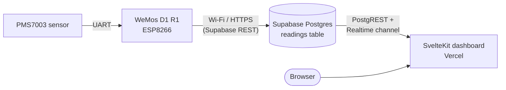
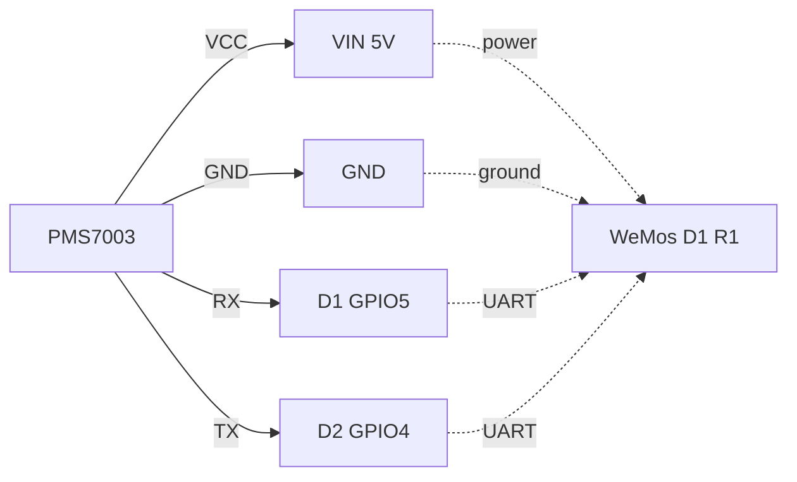

# PMS7003 Cloud Air‑Quality Monitor

An end‑to‑end **PM2.5 / PM10 air‑quality monitoring** stack: a **WeMos D1 R1** (ESP8266) reads a **PMS7003** particulate‑matter sensor over UART, pushes each sample to **Supabase**, and a **SvelteKit** dashboard (deployed to **Vercel**) visualises the readings in near‑real time.

> Status: initial scaffold. The `firmware/src/main.cpp` and `app/src/routes/+page.svelte` are placeholders — this README documents the target architecture so each piece can be filled in.



---

## ✨ Features

- 📡 **Wireless air‑quality node** — no cables back to a laptop; the sensor just needs Wi‑Fi.
- 🌫 **PM1.0 / PM2.5 / PM10** mass‑concentration readings (μg/m³) plus derived AQI.
- ☁️ **Cloud persistence** — every reading lands in Supabase Postgres with a timestamp.
- 📊 **Live dashboard** — Vercel‑hosted SvelteKit UI with charts and recent‑reading cards.
- 🔌 **Cheap & open** — ~$10 of hardware, MIT‑licensed firmware and frontend.

---

## 🧰 Tech stack

| Layer        | Tech                                                          |
| ------------ | ------------------------------------------------------------- |
| Sensor       | Plantower **PMS7003** (laser‑scattering PM sensor, UART 9600) |
| MCU          | **WeMos D1 R1** (ESP8266, 80 MHz, Wi‑Fi)                     |
| Firmware     | **PlatformIO** + Arduino framework, C++                      |
| Backend      | **Supabase** (Postgres + REST + Realtime)                     |
| Frontend     | **SvelteKit 2** + **Svelte 5** + **TypeScript**               |
| Styling      | **Tailwind CSS 4**                                            |
| Deploy       | **Vercel** (via `@sveltejs/adapter-vercel`)                   |
| Package mgr  | **pnpm** (workspace root, in `app/`)                          |

---

## 📁 Repository layout

```
pms7003-esp8266-cloud/
├── README.md          ← you are here
├── LICENSE            ← MIT
├── firmware/          ← PlatformIO project for the WeMos D1 R1
│   ├── platformio.ini
│   ├── include/       ← headers + secrets.h (gitignored)
│   ├── lib/           ← optional local libs
│   ├── src/main.cpp   ← firmware entry point
│   └── test/
└── app/               ← SvelteKit dashboard (Vercel adapter)
    ├── package.json
    ├── svelte.config.js
    ├── vite.config.ts
    └── src/
        ├── app.html
        ├── app.d.ts
        ├── lib/
        └── routes/
            ├── +layout.svelte
            ├── +page.svelte
            └── layout.css
```

---

## 🔌 Hardware

### Bill of materials

| Qty | Part                                | Notes                       |
| --- | ----------------------------------- | --------------------------- |
| 1   | WeMos D1 R1                         | ESP8266, micro‑USB powered  |
| 1   | PMS7003 module                      | UART, 5 V tolerant         |
| 1   | Breadboard + jumper wires           |                             |
| 1   | Micro‑USB cable                     | For power + flashing       |

### Wiring

The PMS7003 speaks UART at **9600 8N1** (3.3 V logic) — connect it to two free GPIOs on the D1 and use `SoftwareSerial` (ESP8266 UART0 is shared with the USB‑serial chip, so don't use `D9`/`D10` for data).

| PMS7003 pin | Wire     | WeMos D1 R1 pin | Notes                          |
| ----------- | -------- | --------------- | ------------------------------ |
| 1 VCC       | red      | **5V / VIN**    | Sensor fan needs 5 V           |
| 2 GND       | black    | **G**           | Common ground                  |
| 5 RX        | green    | **D1** (GPIO5) | MCU **TX** → sensor **RX**    |
| 6 TX        | yellow   | **D2** (GPIO4) | Sensor **TX** → MCU **RX**    |
| 3 / 4 / 7 / 8 | —      | leave floating  | RESET, SET, NC                |



> If you see garbled frames, double‑check the TX/RX crossover — sensor RX must face MCU TX, and vice versa.

### First‑power checklist

1. Let the PMS7003 fan settle for **≥ 30 s** before trusting readings.
2. Open the Arduino IDE / PlatformIO **serial monitor at 9600 baud** and confirm you see `BMEC`/`BME` start bytes (0x42 0x4D) — that's a valid PMS frame.
3. Don't enclose the sensor in a fully sealed box — it needs airflow for the fan.

---

## ☁️ Supabase setup

1. Create a project at [supabase.com](https://supabase.com).
2. In **SQL editor**, run:

   ```sql
   create table public.readings (
     id          bigint generated by default as identity primary key,
     device_id   text        not null,
     pm1_0       real        not null,        -- μg/m³
     pm2_5       real        not null,        -- μg/m³
     pm10        real        not null,        -- μg/m³
     aqi         integer,                    -- optional, derived
     recorded_at timestamptz not null default now()
   );

   create index readings_device_time_idx
     on public.readings (device_id, recorded_at desc);

   -- Enable Row Level Security
   alter table public.readings enable row level security;

   -- The dashboard reads via the anon key (public).
   create policy "readings are publicly readable"
     on public.readings for select
     using (true);

   -- Inserting only happens from the firmware with the service role.
   -- The service role bypasses RLS, so no extra policy is needed.
   ```

3. From **Project Settings → API** copy:
   - **Project URL** (`SUPABASE_URL`)
   - **anon public** key (`SUPABASE_ANON_KEY`) — used by the dashboard
   - **service_role** key (`SUPABASE_SERVICE_ROLE_KEY`) — used by the firmware; treat as a secret.

4. (Optional) Enable **Realtime** on the `readings` table under *Database → Replication* so the dashboard can live‑update without polling.

---

## 🔧 Firmware (`firmware/`)

Built with **PlatformIO**. Target environment: `d1` (WeMos D1 R1, ESP8266, Arduino framework).

### Secrets

Create `firmware/include/secrets.h` (gitignored) so credentials stay out of git:

```cpp
#pragma once

#define WIFI_SSID             "your-ssid"
#define WIFI_PASSWORD         "your-wifi-password"

#define SUPABASE_URL          "https://YOUR-PROJECT.supabase.co"
#define SUPABASE_SERVICE_KEY  "ey...service-role-key..."

// How often to push a reading (ms). PMS7003 spec needs ≥ 1 s of stable airflow.
#define READING_INTERVAL_MS   60000   // 1 min
```

> Alternatively, pass them with `-DWIFI_SSID=\"...\"` build flags in `platformio.ini` — either approach works; pick one and keep it out of git.

### Build & flash

```bash
cd firmware
pio run -e d1 -t upload     # compile + flash over USB
pio device monitor          # open serial monitor @ 9600
```

### Intended behaviour (`src/main.cpp`)

- Connect to Wi‑Fi on boot (blocking, with timeout + retry).
- Drive the PMS7003 via `SoftwareSerial` on `D1`/`D2`, request passive‑mode frames every `READING_INTERVAL_MS`.
- Parse the 32‑byte PMS frame (see the [datasheet](https://cdn-shop.adafruit.com/product-files/4632/PM25_AQI.pdf)): validate the start bytes (`0x42 0x4D`), length (28), and checksum before trusting the payload.
- Compute AQI from PM2.5 using the US EPA breakpoint table.
- `POST` the sample to `${SUPABASE_URL}/rest/v1/readings` with the `apikey` and `Authorization` headers set to the service role key.
- Print structured logs (`[INFO]`, `[WARN]`, `[ERR]`) over UART for debugging.

> The file is currently empty — fill it in using the outline above.

---

## 🖥 Dashboard (`app/`)

SvelteKit 2 + Svelte 5 + Tailwind 4, deployed with the Vercel adapter.

### Local development

```bash
cd app
pnpm install
cp .env.example .env        # fill in values below
pnpm dev                    # http://localhost:5173
```

### Environment variables

Put these in `app/.env` (and in the Vercel project settings):

```bash
PUBLIC_SUPABASE_URL=https://YOUR-PROJECT.supabase.co
PUBLIC_SUPABASE_ANON_KEY=ey...anon-key...
```

> Any var prefixed `PUBLIC_` is exposed to the browser by SvelteKit, which is what we want — the **anon** key is safe in client code as long as RLS is enabled.

### Build & deploy

```bash
pnpm build                  # outputs a Vercel-ready build via @sveltejs/adapter-vercel
pnpm preview                # smoke-test the production build locally
```

Deploy options:

- **Vercel dashboard** — import this repo, set the two env vars above, framework auto‑detected as SvelteKit.
- **Vercel CLI** — `vercel --prod` from the `app/` directory.

### Intended features

- A landing page with the **latest PM2.5 reading** + AQI badge, colour‑coded by US EPA bands.
- A **time‑series chart** (PM1.0 / PM2.5 / PM10 over the last 24 h) using a library like `layerchart` or `chart.js`.
- A **recent readings table** with pagination.
- **Supabase Realtime** subscription so new samples appear without a page refresh.

The current `+page.svelte` is the SvelteKit starter — replace it with the dashboard routes above.

---

## 📐 US EPA AQI breakpoints (for reference)

| AQI   | PM2.5 (μg/m³) | Air quality   |
| ----- | ------------- | ------------- |
| 0–50  | 0.0–12.0      | Good 🟢       |
| 51–100| 12.1–35.4     | Moderate 🟡   |
| 101–150 | 35.5–55.4   | Unhealthy for sensitive 🟠 |
| 151–200 | 55.5–150.4  | Unhealthy 🔴  |
| 201–300 | 150.5–250.4 | Very unhealthy 🟣 |
| 301+  | 250.5+       | Hazardous 🟤  |

Implementation in firmware or dashboard — pick whichever side owns the formula. The README uses EPA's PM2.5 breakpoints from [AirNow.gov](https://www.airnow.gov/aqi/aqi-basics/).

---

## 🛠 Development workflow

```bash
# Top-level (no root package.json — each project manages its own deps)
(cd firmware && pio run -e d1)           # build firmware
(cd app      && pnpm install && pnpm dev) # run dashboard
```

Lint / type‑check the dashboard:

```bash
cd app
pnpm lint         # prettier --check + eslint
pnpm check        # svelte-check (svelte + ts diagnostics)
```

---

## 🗺 Roadmap

- [ ] Firmware: Wi‑Fi connect + PMS7003 frame parser
- [ ] Firmware: Supabase REST `POST` of readings
- [ ] Firmware: AQI computation + serial logging
- [ ] Dashboard: latest‑reading card + AQI badge
- [ ] Dashboard: time‑series chart
- [ ] Dashboard: Realtime channel subscription
- [ ] OTA firmware updates (`ArduinoOTA` or HTTP)
- [ ] Add DHT22/BME280 for temperature & humidity alongside PM
- [ ] Multi‑device support (filter by `device_id`)

---

## 🩺 Troubleshooting

| Symptom                       | Likely cause                                         |
| ----------------------------- | ---------------------------------------------------- |
| Serial monitor prints garbage | Baud mismatch (must be 9600) or TX/RX swapped        |
| Readings stuck near 0         | Sensor fan not spinning — check 5 V supply           |
| `401 Unauthorized` from Supabase | Wrong API key; firmware needs **service_role**, not anon |
| `400 Bad Request` on insert   | Column type mismatch — `pm*` values must be `real`, not integer |
| Dashboard loads but no data  | RLS policy missing the `select` rule, or wrong URL/key |
| `brownout detector was triggered` | USB cable is charge‑only or under‑current — use a data cable or a stronger supply |

---

## 📜 License

MIT — see [`LICENSE`](./LICENSE). © 2026 Phukrit Kittinontana.

## 🙏 Acknowledgements

- [Plantower](https://www.plantower.com/) for the PMS7003 sensor and reference frame format.
- [AirNow](https://www.airnow.gov/) for the AQI breakpoints used by US embassies worldwide.
- The Svelte, Supabase and PlatformIO communities for the excellent docs that make this stack achievable on a weekend.
